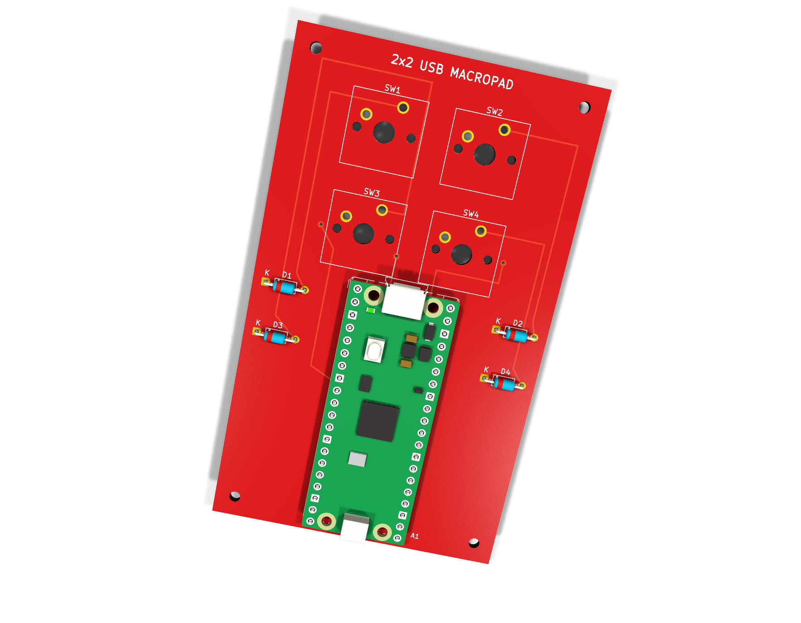
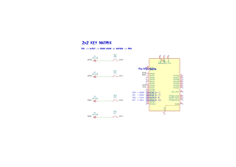
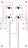
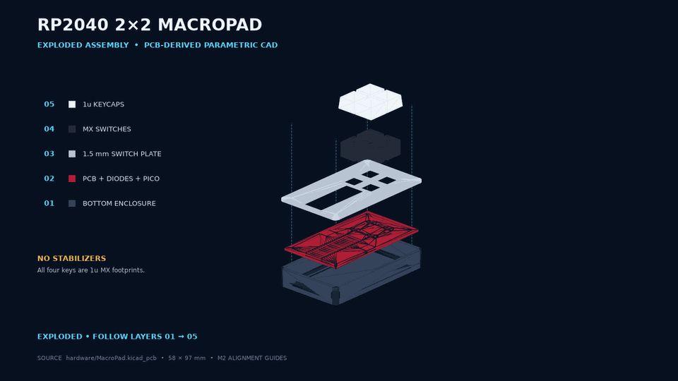

# RP2040 Custom 2x2 USB Mechanical Macropad

[](https://github.com/codejupiter/rp2040-macropad/actions/workflows/build.yml)


<p align="center">
  
</p>

A compact, open-hardware USB macropad built around the Raspberry Pi Pico. Four MX-compatible switches, one diode per key, and native TinyUSB HID firmware create a driverless keyboard that works on macOS, Windows, Linux, and other USB HID hosts. The included app-launcher configuration targets macOS and can be replaced with any HID shortcuts you prefer.

## At a glance

| | |
| --- | --- |
| Microcontroller | Raspberry Pi Pico / RP2040 |
| Layout | 2x2, standard 19.05 mm key pitch |
| Matrix pins | Rows: GP0, GP1 · Columns: GP6, GP7 |
| Switch isolation | Four 1N4148 diodes |
| USB | TinyUSB HID boot keyboard |
| Firmware | C++17, official Raspberry Pi Pico SDK |
| PCB | 58 x 97 mm · 2 layers · 1.6 mm FR-4 · red solder mask |
| Host software | None |

## Features

- Four independently programmable mechanical keys
- Diode-isolated matrix with debounced multi-key input
- Standard USB keyboard reports—no driver or background application
- Pico unique-ID-based USB serial number
- USB remote wake when the host permits it
- Project-local TinyUSB configuration propagated correctly through CMake
- USB stdio disabled to prevent a second device stack from colliding with HID
- One-command build and automatic `picotool`/BOOTSEL flashing
- Editable KiCad source, clean design exports, and ready-to-order fabrication files
- Automated firmware build on every push and pull request

## Design

<table>
  <tr>
    <td width="50%" align="center"><strong>Schematic</strong></td>
    <td width="50%" align="center"><strong>Routed PCB</strong></td>
  </tr>
  <tr>
    <td></td>
    <td></td>
  </tr>
</table>

The columns are inputs with the Pico's internal pull-ups enabled. During a scan, the firmware drives one row low, samples both columns, then returns that row to high impedance before selecting the next row.

```text
COL0 ── SW1 ── A D1 K ── ROW0
COL1 ── SW2 ── A D2 K ── ROW0
COL0 ── SW3 ── A D3 K ── ROW1
COL1 ── SW4 ── A D4 K ── ROW1
```

The diode cathode—the end marked by the stripe—faces the row net. The PCB silkscreen marks that pad with `K`.

### Exploded mechanical assembly

<p align="center">
  
</p>

The printable [bottom enclosure and switch plate](hardware/mechanical/) are generated parametrically from the committed KiCad board outline, footprint drills, switch centers, Pico envelope, and M2 mounting holes. The animation shows the correct bottom-to-top stack and uses cyan guides for the shared mounting axes. The four keys are 1u and therefore use no stabilizers.

### Pin map

| Matrix net | Pico GPIO | Pico physical pin | Keys |
| --- | ---: | ---: | --- |
| `ROW0` | GP0 | 1 | SW1, SW2 |
| `ROW1` | GP1 | 2 | SW3, SW4 |
| `COL0` | GP6 | 9 | SW1, SW3 |
| `COL1` | GP7 | 10 | SW2, SW4 |

## Repository layout

```text
.
├── CMakeLists.txt              Firmware build definition
├── main.cpp                    Matrix scanner and USB HID device
├── tusb_config.h               TinyUSB device configuration
├── flash_macropad.sh           Automatic flashing watcher
├── hardware/
│   ├── MacroPad.kicad_pro      KiCad project
│   ├── MacroPad.kicad_sch      Schematic source
│   ├── MacroPad.kicad_pcb      PCB source
│   ├── BOM.csv                 Bill of materials
│   ├── mechanical/             Parametric case, plate, STL/STEP files, and generator
│   ├── manufacturing/          Ready-to-order Gerber/drill package
│   └── reports/                ERC and DRC reports
└── docs/
    ├── ASSEMBLY.md             Assembly and bring-up guide
    └── images/                 Generated design visuals
```

## Bill of materials

| Qty. | Reference | Part | Notes |
| ---: | --- | --- | --- |
| 1 | A1 | Raspberry Pi Pico | Original Pico form factor, RP2040 |
| 4 | SW1–SW4 | MX-compatible switch | PCB-mount or plate-mount |
| 4 | D1–D4 | 1N4148 diode | DO-35, 7.62 mm pitch |
| 4 | — | 1u keycap | Any MX-compatible profile |
| 2 | — | 1x20, 2.54 mm male header | Pico connections |
| 2 | — | 1x20, 2.54 mm socket | Optional; makes the Pico removable |
| 4 | H1–H4 | M2 screw and standoff | Optional case/baseplate mounting |
| 1 | — | USB data cable | Micro-USB for the original Pico |

The machine-readable version is in [`hardware/BOM.csv`](hardware/BOM.csv).

## Build the firmware

### Requirements

- CMake 3.13 or newer
- Ninja or Make
- Arm GNU Toolchain for `arm-none-eabi`
- Official [Raspberry Pi Pico C/C++ SDK](https://github.com/raspberrypi/pico-sdk) with submodules

```bash
git clone https://github.com/codejupiter/rp2040-macropad.git
cd rp2040-macropad

export PICO_SDK_PATH=/absolute/path/to/pico-sdk
cmake -S . -B build -DCMAKE_BUILD_TYPE=Release
cmake --build build --parallel
```

The flashable image is written to `build/macropad.uf2`. The build also emits ELF, BIN, HEX, disassembly, and linker-map files for debugging.

### Default app shortcuts

The included firmware turns the physical 2x2 grid into a macOS application launcher:

| Key | Position | Action |
| --- | --- | --- |
| SW1 | Top left | Open KiCad with Spotlight |
| SW2 | Top right | Open VS Code for the Web (`vscode.dev`) in Chrome |
| SW3 | Bottom left | Open `github.com/codejupiter` in Chrome |
| SW4 | Bottom right | Open the ChatGPT/Codex desktop app with Spotlight |

SW1 and SW4 send Command+Space, type the installed application name, and press Enter. SW2 and SW3 launch Google Chrome, focus the address bar, and enter their URLs. Spotlight must use its standard Command+Space shortcut and the applications must be installed under searchable names. Presses made while another macro is running are queued and played in grid order. The Pico's onboard LED remains lit while a debounced switch is held, providing immediate confirmation that the physical matrix registered the press.

To customize the actions, edit `kKicadMacro`, `kVsCodeMacro`, `kGitHubMacro`, and `kCodexMacro` in [`main.cpp`](main.cpp), then rebuild and flash. The non-blocking macro engine supports key taps with modifiers, text entry, and timed delays. Because the device sends standard USB HID keyboard reports, no host-side driver or background utility is required.

> The example USB VID/PID is suitable for development, not for a commercial product. Obtain an appropriate allocation before distributing hardware at scale.

## Flash the Pico

The included watcher waits for a Pico, prefers a USB-capable `picotool`, and falls back to copying the UF2 to a mounted `RPI-RP2` or `RP2350` BOOTSEL volume.

```bash
./flash_macropad.sh
```

If the Pico is not detected automatically, unplug it, hold **BOOTSEL**, reconnect USB, then release the button. You can also pass a different UF2 explicitly:

```bash
./flash_macropad.sh /path/to/firmware.uf2
```

After flashing, the Pico reboots and enumerates as `RP2040 2x2 Macropad`. See the [assembly and bring-up guide](docs/ASSEMBLY.md) for first-power checks.

## Manufacture the PCB

The ready-to-upload archive is [`hardware/manufacturing/macropad_gerbers.zip`](hardware/manufacturing/macropad_gerbers.zip). It contains both copper layers, both mask layers, both silkscreen layers, the board outline, and separate plated/non-plated drill files.

Before ordering, open the archive in your manufacturer's Gerber viewer and confirm:

- 58 x 97 mm finished dimensions
- two copper layers and 1.6 mm FR-4
- red solder mask and white silkscreen
- plated Pico/switch/diode holes and non-plated M2 holes
- correct diode polarity and accessible Pico USB connector

Source and fabrication details are documented in [`hardware/README.md`](hardware/README.md).

## Validation status

- Firmware: clean release build with Pico SDK 2.3.1
- Schematic ERC: 0 errors, 0 warnings
- PCB DRC: 0 shorts, 0 clearance errors, 0 unrouted connections
- Fabrication archive: integrity checked; 9 Gerber/drill files

The stored DRC report includes library-difference advisories caused by intentionally edited reference/value text positions. They do not represent electrical or manufacturing errors.

## Contributing

Contributions are welcome. Please read [`CONTRIBUTING.md`](CONTRIBUTING.md) before opening an issue or pull request. Hardware changes should include updated KiCad sources, regenerated exports, fresh ERC/DRC reports, and inspected manufacturing outputs.

## License

Firmware, scripts, and documentation are released under the [MIT License](LICENSES/MIT.txt). Hardware design sources and fabrication files are released under the [CERN Open Hardware Licence Version 2 – Permissive](LICENSES/CERN-OHL-P-2.0.txt). See [`LICENSE`](LICENSE) for the scope of each license.

---

Built for experimentation, repeatable hardware iteration, and a satisfyingly small number of very clicky buttons.
